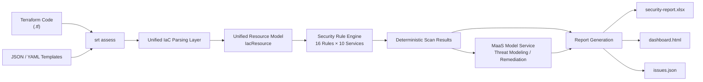

# IaC Security Review Tool (srt)

<!-- Standard Ch.1 · Title & Badges [CRITICAL] -->
[](LICENSE)
[](https://support.huaweicloud.com/intl/en-us/)
[](https://www.huaweicloud.com/)
[](#)

> A locally run infrastructure-as-code (IaC) security review CLI: it performs deterministic rule scanning on **Terraform (.tf)** and **JSON / YAML templates**, and optionally invokes the **MaaS hosted model service (ModelArts Studio)** for threat modeling and remediation suggestions, producing three report formats — Excel / HTML / JSON.

---

<!-- Standard Ch.2 · Introduction / Overview [CRITICAL] -->
## 1. Introduction / Overview [CRITICAL]

**English**: This CLI performs deterministic security rule scanning on Huawei Cloud infrastructure-as-code (Terraform / JSON / YAML templates) and optionally enhances results with threat modeling and remediation suggestions generated by a MaaS-hosted model, producing Excel / HTML / JSON reports. It targets developers and solution teams who need to quickly check the security of their Huawei Cloud infrastructure code before committing or merging. It integrates "rule scanning + model enhancement" into a single local command, `srt assess`: it applies 16 deterministic security rules to the `.tf`, `.yaml`, and `.json` files in a directory, and emits a readable, severity-graded report on any hits; when a model key is configured, it also automatically generates threat models and remediation suggestions for high-risk findings. Suitable for local development checks, CI pipeline quality gates, and routine security team inspections.

### Core Capabilities

- **Local CLI, zero cloud dependency**: The tool itself is not deployed to the cloud; install and run, and it can run fully offline (`--no-threat-models` skips model enhancement).
- **Unified IaC parsing**: Supports both Terraform and generic JSON / YAML templates, normalizing them into a unified resource model, decoupling rule authoring from the scanning engine.
- **Deterministic rule engine**: 16 built-in rules covering ten services — OBS / Security Group / CCE / RDS / ECS / ELB / GaussDB / FunctionGraph / IAM / VPC.
- **Model enhancement**: The MaaS hosted model service (OpenAI-compatible protocol) generates threat models and remediation suggestions; the key is never written to disk, the endpoint is configurable, and it degrades gracefully on failure.
- **Multi-format reports**: Excel detail, HTML dashboard, and machine-readable issues.json (CI-assertion friendly), integrated with the `srt fix` / `srt status` closed-loop workflow.

---

<!-- Standard Ch.3 · Table of Contents [MINOR] -->
## 2. Table of Contents [MINOR]

- [1. Introduction / Overview](#1-introduction--overview-critical)
- [2. Table of Contents](#2-table-of-contents-minor)
- [3. Architecture Diagram](#3-architecture-diagram-minor)
- [4. Highlights](#4-highlights-minor)
- [5. Cloud Services Involved](#5-cloud-services-involved-minor)
- [6. Prerequisites](#6-prerequisites-critical)
- [7. Quick Start](#7-quick-start-critical)
- [8. Step-by-Step Deployment](#8-step-by-step-deployment-minor)
- [9. Usage / Verification](#9-usage--verification-critical)
- [10. Cleaning Up Resources](#10-cleaning-up-resources-minor)
- [11. Detailed Description](#11-detailed-description-minor)
- [12. Dependencies & Acknowledgements](#12-dependencies--acknowledgements-minor)
- [13. FAQ / Troubleshooting](#13-faq--troubleshooting-minor)
- [14. Contributing Guide](#14-contributing-guide-minor)
- [15. License](#15-license-critical)
- [16. Maintainers](#16-maintainers-critical)

---

<!-- Standard Ch.4 · Architecture Diagram [MINOR] -->
## 3. Architecture Diagram [MINOR]



**Flow description**: `srt assess` recursively discovers IaC files in a directory and dispatches them by extension to the HCL subset parser (`.tf`) or the template parser (`.yaml` / `.yml` / `.json`); after normalization into a unified resource model, the rule engine matches by resource type (16 rules). Deterministic scan results are used to generate the three report formats directly; when a model key is configured, the MaaS hosted model service is also invoked in parallel to generate threat models and remediation suggestions for high-risk findings (if no key is configured, this step is skipped gracefully without affecting the deterministic results).

---

<!-- Standard Ch.5 · Highlights [MINOR] -->
## 4. Highlights [MINOR]

- **Runs locally, zero cloud dependency**: The tool itself is not deployed to the cloud; install and run, and it can run fully offline (deterministic scanning does not depend on any cloud service).
- **Unified IaC parsing**: Supports both Terraform and generic JSON / YAML templates, normalizing them into a unified resource model, decoupling rule authoring from the scanning engine.
- **Deterministic rule engine**: 16 built-in rules covering ten Huawei Cloud services; adding a new rule only requires appending a file following the directory pattern.
- **Degradable model enhancement**: The MaaS hosted model service (OpenAI-compatible) generates threat models and remediation suggestions; the key is never written to disk, the endpoint is configurable, and it degrades gracefully on failure.
- **Multi-format reports**: Excel detail, HTML dashboard, and machine-readable issues.json (CI-assertion friendly), integrated with the `srt fix` / `srt status` closed-loop workflow.
- **Credential security**: The model API Key is injected only via environment variable and is never written to any configuration file or repository.

---

<!-- Standard Ch.6 · Cloud Services Involved [MINOR] (C13: fixed section name, no cost info) -->
## 5. Cloud Services Involved [MINOR]

| Category | Huawei Cloud Service | Purpose |
|---|---|---|
| Model | MaaS hosted model service (ModelArts Studio) | Threat modeling / remediation suggestions (optional enhancement) |
| Storage | Object Storage Service OBS (optional) | Audit report archive bucket (`infra/`, not created by default) |

> **Tip**: All services can be created with one click via this repository's Terraform configuration; for cleanup, see [Chapter 10 "Cleaning Up Resources"](#10-cleaning-up-resources-minor).
> Resource specifications and usage notes are kept in the repository's `others/` directory (per C13, such notes are not written into the README).

---

<!-- Standard Ch.7 · Prerequisites [CRITICAL] -->
## 6. Prerequisites [CRITICAL]

| Item | Requirement | Notes |
|---|---|---|
| **Account** | A Huawei Cloud account is activated | Personal or enterprise accounts both work |
| **Credential security** | Model API Key is injected only via the `MODEL_API_KEY` environment variable | **Never write it into code, configuration files, or commit it to the repository** (C8) |
| **Runtime** | `node` ≥ 22 | Build and run |
| **Package manager** | `npm` ≥ 10 (bundled with Node) | Install dependencies and run build / tests |
| **Region constraint** | Default `cn-north-4` | Only the OBS archive bucket is region-bound; the MaaS hosted model service uses a unified access endpoint independent of region |
| **Optional model enhancement** | MaaS hosted model service activated and API Key obtained | Create it in the console "API Key Management"; if not configured, only AI enhancement is skipped — deterministic scanning is unaffected |

---

<!-- Standard Ch.8 · Quick Start / One-Click Deployment [CRITICAL] -->
## 7. Quick Start [CRITICAL]

This tool is a local CLI with no separate "deployment" step; install and run:

```bash
# 1. Install dependencies and build (expected: build/ directory generated)
npm install && npm run build

# 2. Configure the model key (optional, for threat-modeling enhancement)
export MODEL_API_KEY="<YOUR_API_KEY>"

# 3. Review the IaC files under the current directory (expected: graded hit statistics printed to console)
srt assess -p ./infra
```

> When no key is configured, AI enhancement is skipped automatically; deterministic rule scanning still runs normally and is unaffected.

---

<!-- Standard Ch.9 · Step-by-Step Deployment [MINOR] -->
## 8. Step-by-Step Deployment [MINOR]

```bash
# Step 1: Get the code and install dependencies (expected: node_modules generated, no errors)
git clone <this repository URL> iac-security-review-tool
cd iac-security-review-tool
npm install

# Step 2: Build (expected: build/ produced, tsc compiles with zero errors)
npm run build

# Step 3 (optional): Globally symlink so the srt command is available directly (expected: srt on PATH)
npm link

# Step 4: Configure the model (optional, choose either method)
# Method 1: Environment-variable injection (recommended for CI; key never written to disk)
export MODEL_ENDPOINT="https://api.modelarts-maas.com/v2"
export MODEL_API_KEY="<YOUR_API_KEY>"
export MODEL_ID="DeepSeek-V3.2"
# Method 2: srt config interactive configuration (API Key used only for connectivity check, not written to config file)
srt config --endpoint "https://api.modelarts-maas.com/v2" --model-id "DeepSeek-V3.2"

# Step 5: Verify the installation (expected: tool help printed, 5 commands visible)
srt --help

# Step 6: Run the review (expected: file count and graded hit statistics printed)
srt assess -p ./path/to/terraform
```

> To create the optional report archive bucket using infrastructure-as-code, refer to the Terraform files under the repository's `infra/` directory (default `enabled=false`, not created; to enable, run `terraform init && terraform apply -var "enabled=true" -var "bucket_name=<bucket name>"`).

---

<!-- Standard Ch.10 · Usage / Verification [CRITICAL] -->
## 9. Usage / Verification [CRITICAL]

> **Mandatory hands-on test**: The commands / examples in this section were actually executed and verified before delivery — they are runnable and their output matches the description. Please verify by following the steps in this section; the deliverable is considered complete only after confirming the business functionality works.

**Minimal example**: Review the IaC files under `./infra` and generate reports.

```bash
# Review a specified directory
srt assess -p ./infra

# Skip model enhancement (offline / no key)
srt assess -p ./infra --no-threat-models

# View the most recent review summary
srt status
```

Expected output:

```
[Security Matrix Scan] Found 12 IaC files
  Hit 7 rules:
    HIGH   3 items
    MEDIUM 3 items
    LOW    1 item
Report generated: .srt/security-report.xlsx
```

**Verification methods** (to confirm the tool works):

1. **Reproducible build**: `npm run typecheck` with zero errors, `npm run test` all passing (77 cases), `npm run build` produces `build/`.
2. **Commands registered**: `srt --help` shows 5 commands (assess / fix / config / status / update).
3. **Scan executable**: Run `srt assess -p <directory>` against a directory containing `.tf` / `.yaml` / `.json`; the console prints hit statistics.
4. **Reports generated**: Check that `.srt/security-report.xlsx`, `.srt/dashboard.html`, and `.srt/issues.json` exist.
5. **Summary queryable**: `srt status` prints graded statistics; when high-risk items exist, `srt fix` lists the issue清单.
6. **Model connectivity (optional)**: After configuring the key, run `srt config`; the tool performs an endpoint connectivity check and returns the result.

---

<!-- Standard Ch.11 · Cleaning Up Resources [MINOR] -->
## 10. Cleaning Up Resources [MINOR]

```bash
# Local runs create no cloud resources; just delete the report output directory (optional)
rm -rf .srt

# If the optional report archive bucket was enabled, release it to avoid residue
cd infra && terraform destroy -var "enabled=true" -var "bucket_name=<your bucket name>"
```

> Object Storage is billed by storage volume; if data has been archived in the bucket, empty the objects first or wait for the lifecycle rule to expire before releasing, to avoid residual storage resources.

---

<!-- Standard Ch.12 · Detailed Description [MINOR] -->
## 11. Detailed Description [MINOR]

### 11.1 Workflow

1. **Discovery**: Recursively scan the target directory, matching `**/*.tf`, `**/*.yaml`, `**/*.yml`, `**/*.json`, while excluding `node_modules`, `.git`, `.terraform`, `build`, `dist`, `.srt`, etc.; JSON files are filtered by the keywords template / stack / config / parameter to avoid mis-scanning ordinary configuration.
2. **Parsing**: Dispatched by extension — `.tf` goes to the HCL subset parser (parses `resource "type" "name" {}` blocks and scalar / list / map / nested blocks); `.yaml` / `.yml` / `.json` go to the template parser (with built-in function evaluation). Both are normalized into a unified resource model.
3. **Scanning**: The rule engine indexes by `resource.type`, evaluates matching rules per resource, and emits a `ScanResult` on any hit (containing check ID, priority, description, and remediation suggestion).
4. **Enhancement (optional)**: When high-risk results exist and a model key is configured, the MaaS hosted model service is invoked to generate threat models and remediation suggestions for the high-risk items; if no key is configured, this is skipped without affecting deterministic results.
5. **Reporting**: Aggregated and written to `.srt/`: `security-report.xlsx`, `dashboard.html`, `issues.json`; a graded summary is printed to the console.

### 11.2 Built-in Security Rules (16)

| Service | Rule | Priority | Detects |
|---|---|---|---|
| OBS | OBS-001 | HIGH | Bucket server-side encryption not enabled |
| OBS | OBS-002 | HIGH | Bucket ACL / policy allows public read-write |
| Security Group | SEC-001 | HIGH | Inbound rule allows access from the entire internet (0.0.0.0/0) |
| Security Group | SEC-002 | HIGH | Management ports SSH(22)/RDP(3389) open to the entire internet |
| CCE | CCE-001 | HIGH | Cluster control plane exposed to public internet |
| CCE | CCE-002 | MEDIUM | Cluster audit logging not enabled |
| RDS | RDS-001 | HIGH | Database instance exposed to public internet |
| RDS | RDS-002 | MEDIUM | Automated backup not enabled for the instance |
| ECS | ECS-001 | MEDIUM | ECS directly bound to an elastic public IP |
| ELB | ELB-001 | HIGH | Listener TLS encryption not enabled |
| ELB | ELB-002 | LOW | Load balancer access logging not enabled |
| GaussDB | GAUSS-001 | MEDIUM | Database instance automated backup not enabled |
| GaussDB | GAUSS-002 | HIGH | Database instance exposed to public internet |
| FunctionGraph | FGS-001 | HIGH | Function environment variables contain plaintext sensitive information |
| IAM | IAM-001 | HIGH | Agency (agency) granted excessive permissions |
| VPC | VPC-001 | LOW | Elastic public IP appears orphaned / unbound |

> The rule library is located at `src/assess/scanning/security-matrix/rules/huaweicloud/<service>/`; to add a rule, implement the `BaseRule` interface and register it in the corresponding `index.ts`.

### 11.3 Configuration Items

| Environment Variable | Default | Description |
|---|---|---|
| `MODEL_ENDPOINT` | `https://api.modelarts-maas.com/v2` | MaaS hosted model service OpenAI-compatible endpoint |
| `MODEL_API_KEY` | none | Model access key (injected only via environment variable, never written to disk) |
| `MODEL_ID` | `DeepSeek-V3.2` | Model name (use the subscribed MaaS model name, e.g. `GLM-4` / `Qwen3-32B` / `openPangu-2.0-Flash`) |
| `SRT_UPDATE_URL` | placeholder URL | Update source for `srt update`; can point to an internal artifact repository |

> Configuration (endpoint, model ID, etc.) is written to `<project>/.srt/srtconfig.json`; `srt config --api-key` interactive input only triggers a one-time connectivity check and is not written to the configuration file.

### 11.4 Report Artifacts

| File | Description |
|---|---|
| `.srt/security-report.xlsx` | Excel report: issues and remediation suggestions grouped by service |
| `.srt/dashboard.html` | Visual dashboard: priority distribution + per-service statistics |
| `.srt/issues.json` | Machine-readable issue list (Open status) for CI assertions and `srt fix` / `srt status` |

---

<!-- Standard Ch.13 · Dependencies & Acknowledgements [MINOR] -->
## 12. Dependencies & Acknowledgements [MINOR]

### Main Dependencies

| Name | Purpose |
|---|---|
| `commander` | CLI command framework |
| `chalk` | Terminal styling |
| `exceljs` | Excel reports |
| `glob` | File discovery |
| `inquirer` | Interactive input |
| `js-yaml` | Template parsing |
| `ora` | Progress indicator |
| `winston` | Logging |
| `zod` | Configuration validation |

### Dev Dependencies

`typescript`, `vitest`, `tsx`, `@biomejs/biome`.

### Acknowledgements

The model enhancement capability is based on the **Huawei Cloud ModelArts Studio MaaS hosted model service** (OpenAI-compatible protocol). This practice is maintained by the **Public Cloud Continuous Operations Department**.

---

<!-- Standard Ch.14 · FAQ / Troubleshooting [MINOR] -->
## 13. FAQ / Troubleshooting [MINOR]

**Q1: Empty scan results?**
Confirm the target directory contains `.tf` / `.yaml` / `.yml` / `.json` files; JSON files are recognized as IaC only if they contain the keywords template / stack / config / parameter — ordinary configuration files are skipped.

**Q2: Model enhancement not taking effect?**
Check whether `MODEL_API_KEY` is set and whether `MODEL_ENDPOINT` and `MODEL_ID` are correct; run `srt config` to verify endpoint connectivity. When no key is configured, the tool skips gracefully — this is expected behavior.

**Q3: Parsing warnings appear?**
The HCL parser covers a subset of `resource` blocks; `variable` / `data` / function expressions do not participate in rule matching — this is by design. For complex expression scenarios, you can fall back to Checkov (with the Huawei Cloud ruleset) as a complement.

**Q4: How to extend the security rules?**
Add a rule file under `src/assess/scanning/security-matrix/rules/huaweicloud/<service>/` (implement the `BaseRule` interface) and register it in that directory's `index.ts`; after adding `tests/rules/<service>.test.ts` cases, run `npm run test`.

---

<!-- Standard Ch.15 · Contributing Guide [MINOR] -->
## 14. Contributing Guide [MINOR]

Issues and Pull Requests are welcome. Before submitting, please ensure:

```bash
npm run typecheck   # tsc --noEmit with zero errors
npm run test        # vitest all passing (77 cases)
npm run build       # build succeeds
```

Please follow the repository conventions: secure credential injection (API Key via environment variable only, zero plaintext keys), and new rules placed by the directory pattern with accompanying tests. See `CONTRIBUTING.md` for details.

---

<!-- Standard Ch.16 · License [CRITICAL] -->
## 15. License [CRITICAL]

This practice is released under the **MIT No Attribution** license. See the [`LICENSE`](LICENSE) file at the repository root for details.

```
MIT No Attribution

Copyright (c) Huawei Cloud

Permission is hereby granted, free of charge, to any person obtaining a copy
of this software... (no attribution required)
```

> License provenance and related statements are detailed in `others/license-modification-log.md` (generated per SKILL C12).

---

<!-- Standard Ch.17 · Contact / Maintainers [CRITICAL] -->
## 16. Maintainers [CRITICAL]

| Item | Content |
|---|---|
| **Maintainers * | zhangcheng123321 |