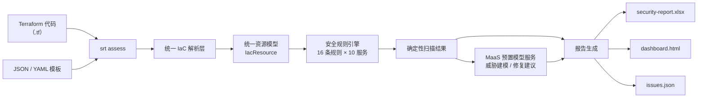

# IaC 安全审查工具（srt）

<!-- 标准第 1 章 · 标题与徽章 [CRITICAL] -->
[](LICENSE)
[](https://support.huaweicloud.com/intl/en-us/)
[](https://www.huaweicloud.com/)
[](#)

> 一个本地运行的基础设施即代码（IaC）安全审查 CLI：对 **Terraform（.tf）** 与 **JSON/YAML 模板**执行确定性规则扫描，并可选调用 **MaaS 预置模型服务（ModelArts Studio）** 进行威胁建模与修复建议增强，产出 Excel / HTML / JSON 三类报告。

---

<!-- 标准第 2 章 · 简介/概述 [CRITICAL] -->
## 1. 简介 / Overview [CRITICAL]

**中文**：本工具面向需要在提交 / 合并前快速检查华为云基础设施代码安全性的开发者与解决方案团队。它把「规则扫描 + 模型增强」整合为一条本地命令 `srt assess`：对目录内的 `.tf`、`.yaml`、`.json` 文件执行 16 条确定性安全规则，命中即产出可读的分级报告；配置模型密钥后，还会对高危项自动生成威胁模型与修复建议。适用于本地开发检查、CI 流水线质量门禁、以及安全团队例行巡检。

**English**: This CLI performs deterministic security rule scanning on Huawei Cloud infrastructure-as-code (Terraform / JSON / YAML templates) and optionally enhances results with threat modeling and remediation suggestions generated by a MaaS-hosted model, producing Excel / HTML / JSON reports.

### 核心能力

- **本地 CLI、零云依赖**：工具本身不部署在云上，安装即用，可完全离线运行（`--no-threat-models` 跳过模型增强）。
- **统一 IaC 解析**：同时支持 Terraform 与通用 JSON / YAML 模板，归一化为统一资源模型，规则编写与扫描引擎解耦。
- **确定性规则引擎**：16 条内置规则覆盖 OBS / 安全组 / CCE / RDS / ECS / ELB / GaussDB / FunctionGraph / IAM / VPC 十大服务。
- **模型增强**：MaaS 预置模型服务（OpenAI 兼容协议）生成威胁模型与修复建议；密钥不落盘、端点可配置、失败可降级。
- **多形态报告**：Excel 明细、HTML 仪表盘、issues.json 机器可读（CI 断言友好），配合 `srt fix` / `srt status` 闭环处理。

---

<!-- 标准第 3 章 · 目录 [MINOR] -->
## 2. 目录 [MINOR]

- [1. 简介 / Overview](#1-简介--overview-critical)
- [2. 目录](#2-目录-minor)
- [3. 架构图](#3-架构图-minor)
- [4. 方案亮点](#4-方案亮点-minor)
- [5. 涉及云服务](#5-涉及云服务-minor)
- [6. 前置条件](#6-前置条件-critical)
- [7. 快速开始](#7-快速开始-critical)
- [8. 分步部署](#8-分步部署-minor)
- [9. 使用方法 / 验证](#9-使用方法--验证-critical)
- [10. 清理资源](#10-清理资源-minor)
- [11. 详细说明](#11-详细说明-minor)
- [12. 依赖与致谢](#12-依赖与致谢-minor)
- [13. FAQ / 故障排除](#13-faq--故障排除-minor)
- [14. 贡献指南](#14-贡献指南-minor)
- [15. 许可证](#15-许可证-critical)
- [16. 维护者](#16-维护者-critical)

---

<!-- 标准第 4 章 · 架构图 [MINOR] -->
## 3. 架构图 [MINOR]



**流程说明**：`srt assess` 递归发现目录中的 IaC 文件，按扩展名分发到 HCL 子集解析器（`.tf`）或模板解析器（`.yaml` / `.yml` / `.json`），归一化为统一资源模型后由规则引擎按资源类型执行匹配（16 条规则）；确定性扫描结果直接生成三类报告，配置模型密钥时同步调用 MaaS 预置模型服务对高危项做威胁建模与修复建议增强（未配置密钥则优雅跳过，不影响确定性结果）。

---

<!-- 标准第 5 章 · 方案亮点 [MINOR] -->
## 4. 方案亮点 [MINOR]

- **本地运行、零云依赖**：工具本身不部署在云上，安装即用，可完全离线运行（确定性扫描不依赖任何云服务）。
- **统一 IaC 解析**：同时支持 Terraform 与通用 JSON / YAML 模板，归一化为统一资源模型，规则编写与扫描引擎解耦。
- **确定性规则引擎**：16 条内置规则覆盖十大华为云服务，新增规则只需按目录模式追加文件。
- **模型增强可降级**：MaaS 预置模型服务（OpenAI 兼容）生成威胁模型与修复建议；密钥不落盘、端点可配置、失败可降级。
- **多形态报告**：Excel 明细、HTML 仪表盘、issues.json 机器可读（CI 断言友好），配合 `srt fix` / `srt status` 闭环处理。
- **凭据安全**：模型 API Key 仅从环境变量注入，不写入任何配置文件或仓库。

---

<!-- 标准第 6 章 · 涉及云服务 [MINOR]（C13：章节名固定、禁写费用） -->
## 5. 涉及云服务 [MINOR]

| 类别 | 华为云服务 | 用途 |
|---|---|---|
| 模型 | MaaS 预置模型服务（ModelArts Studio） | 威胁建模 / 修复建议（可选增强） |
| 存储 | 对象存储 OBS（可选） | 审查报告归档桶（`infra/`，默认不创建） |

> **提示**：所有服务均可通过本仓库的 Terraform 配置一键创建；如需清理，请参见 [第 10 章「清理资源」](#10-清理资源-minor)。
> 资源规格与用量说明统一存放于仓库 `others/` 目录（C13 要求相关说明不写入 README）。

---

<!-- 标准第 7 章 · 前置条件 [CRITICAL] -->
## 6. 前置条件 [CRITICAL]

| 项 | 要求 | 说明 |
|---|---|---|
| **账号** | 已开通华为云账号 | 个人 / 企业账号均可 |
| **凭据安全** | 模型 API Key 仅以环境变量 `MODEL_API_KEY` 注入 | **不可写入代码、配置文件或提交到仓库**（C8） |
| **运行时** | `node` ≥ 22 | 构建与运行 |
| **包管理器** | `npm` ≥ 10（随 Node 自带） | 安装依赖与执行构建 / 测试 |
| **区域约束** | 默认 `cn-north-4` | 仅 OBS 归档桶受区域约束；MaaS 预置模型服务为统一接入点，与区域无关 |
| **可选模型增强** | 已开通 MaaS 预置模型服务并获取 API Key | 在控制台「API Key 管理」创建；未配置则仅跳过 AI 增强，确定性扫描不受影响 |

---

<!-- 标准第 8 章 · 快速开始/一键部署 [CRITICAL] -->
## 7. 快速开始 [CRITICAL]

本工具为本地 CLI，无独立「部署」步骤，安装即用：

```bash
# 1. 安装依赖并构建（预期：生成 build/ 目录）
npm install && npm run build

# 2. 配置模型密钥（可选，用于威胁建模增强）
export MODEL_API_KEY="<YOUR_API_KEY>"

# 3. 审查当前目录下的 IaC 文件（预期：控制台输出分级命中统计）
srt assess -p ./infra
```

> 未配置密钥时 AI 增强自动跳过，确定性规则扫描照常执行，不影响使用。

---

<!-- 标准第 9 章 · 分步部署 [MINOR] -->
## 8. 分步部署 [MINOR]

```bash
# 步骤 1：获取代码并安装依赖（预期：node_modules 生成，无报错）
git clone <本仓库地址> iac-security-review-tool
cd iac-security-review-tool
npm install

# 步骤 2：构建（预期：产出 build/，tsc 编译零错误）
npm run build

# 步骤 3（可选）：全局软链，之后可直接使用 srt 命令（预期：srt 进入 PATH）
npm link

# 步骤 4：配置模型（可选，两种方式任选其一）
# 方式一：环境变量注入（CI 推荐，密钥不落盘）
export MODEL_ENDPOINT="https://api.modelarts-maas.com/v2"
export MODEL_API_KEY="<YOUR_API_KEY>"
export MODEL_ID="DeepSeek-V3.2"
# 方式二：srt config 交互配置（API Key 仅用于连通性校验，不写入配置文件）
srt config --endpoint "https://api.modelarts-maas.com/v2" --model-id "DeepSeek-V3.2"

# 步骤 5：验证安装（预期：打印工具帮助信息，5 个命令可见）
srt --help

# 步骤 6：运行审查（预期：输出文件数与分级命中统计）
srt assess -p ./path/to/terraform
```

> 如需用基础设施即代码创建可选报告归档桶，可参考仓库 `infra/` 目录下的 Terraform 文件（默认 `enabled=false` 不创建；启用需 `terraform init && terraform apply -var "enabled=true" -var "bucket_name=<桶名>"`）。

---

<!-- 标准第 10 章 · 使用方法/验证 [CRITICAL] -->
## 9. 使用方法 / 验证 [CRITICAL]

> **强制实测**：本节所列命令 / 示例在交付前已经实际执行验证，可运行且输出与描述一致。请按本节步骤自行验证，确认业务功能可用后方可视为交付完成。

**最简示例**：审查 `./infra` 目录下的 IaC 文件并生成报告。

```bash
# 审查指定目录
srt assess -p ./infra

# 跳过模型增强（离线 / 无密钥）
srt assess -p ./infra --no-threat-models

# 查看最近一次审查摘要
srt status
```

预期输出：

```
[安全矩阵扫描] 发现 12 个 IaC 文件
  命中规则 7 项：
    HIGH   3 项
    MEDIUM 3 项
    LOW    1 项
报告已生成：.srt/security-report.xlsx
```

**验证方法**（确认工具可用）：

1. **构建可复现**：`npm run typecheck` 零错误、`npm run test` 全部通过（77 用例）、`npm run build` 产出 `build/`。
2. **命令已注册**：`srt --help` 显示 5 个命令（assess / fix / config / status / update）。
3. **扫描可执行**：对含 `.tf` / `.yaml` / `.json` 的目录执行 `srt assess -p <目录>`，控制台输出命中统计。
4. **报告已生成**：检查 `.srt/security-report.xlsx`、`.srt/dashboard.html`、`.srt/issues.json` 三个文件是否存在。
5. **摘要可查**：`srt status` 输出分级统计；存在高危项时 `srt fix` 列出问题清单。
6. **模型连通（可选）**：配置密钥后执行 `srt config`，工具会做一次端点连通性校验并返回结果。

---

<!-- 标准第 11 章 · 清理资源 [MINOR] -->
## 10. 清理资源 [MINOR]

```bash
# 本地运行无云资源，删除报告产物目录即可（可选）
rm -rf .srt

# 若启用了可选报告归档桶，释放以避免残留
cd infra && terraform destroy -var "enabled=true" -var "bucket_name=<你的桶名>"
```

> 对象存储按存储量持续计费，若桶内已归档数据，请先清空对象或等待生命周期规则过期后再释放，避免残留存储资源。

---

<!-- 标准第 12 章 · 详细说明 [MINOR] -->
## 11. 详细说明 [MINOR]

### 11.1 工作流程

1. **发现**：递归扫描目标目录，匹配 `**/*.tf`、`**/*.yaml`、`**/*.yml`、`**/*.json`，排除 `node_modules`、`.git`、`.terraform`、`build`、`dist`、`.srt` 等目录；JSON 文件按 template / stack / config / parameter 关键字过滤，避免误扫普通配置。
2. **解析**：按扩展名分发——`.tf` 进入 HCL 子集解析器（解析 `resource "type" "name" {}` 块与标量 / list / map / 嵌套块）；`.yaml` / `.yml` / `.json` 进入模板解析器（内建函数求值）。两者归一化为统一资源模型。
3. **扫描**：规则引擎按 `resource.type` 建立索引，逐资源执行匹配规则求值，命中即产出 `ScanResult`（含检查项 ID、优先级、问题描述、修复建议）。
4. **增强（可选）**：存在高危结果且已配置模型密钥时，调用 MaaS 预置模型服务对高危项生成威胁模型与修复建议；未配置密钥则跳过，不影响确定性结果。
5. **报告**：汇总写入 `.srt/`：`security-report.xlsx`、`dashboard.html`、`issues.json`，控制台打印分级摘要。

### 11.2 内置安全规则（16 条）

| 服务 | 规则 | 优先级 | 检测内容 |
|---|---|---|---|
| OBS | OBS-001 | HIGH | 桶未启用服务端加密 |
| OBS | OBS-002 | HIGH | 桶 ACL / 策略允许公开读写 |
| 安全组 | SEC-001 | HIGH | 入站规则允许全网（0.0.0.0/0）访问 |
| 安全组 | SEC-002 | HIGH | SSH(22)/RDP(3389) 管理端口对全网开放 |
| CCE | CCE-001 | HIGH | 集群控制面开放公网访问 |
| CCE | CCE-002 | MEDIUM | 集群未启用审计日志 |
| RDS | RDS-001 | HIGH | 数据库实例开放公网访问 |
| RDS | RDS-002 | MEDIUM | 实例未启用自动备份 |
| ECS | ECS-001 | MEDIUM | 云服务器直接绑定弹性公网 IP |
| ELB | ELB-001 | HIGH | 监听器未启用 TLS 加密 |
| ELB | ELB-002 | LOW | 负载均衡未开启访问日志 |
| GaussDB | GAUSS-001 | MEDIUM | 数据库实例未启用自动备份 |
| GaussDB | GAUSS-002 | HIGH | 数据库实例开放公网访问 |
| FunctionGraph | FGS-001 | HIGH | 函数环境变量含明文敏感信息 |
| IAM | IAM-001 | HIGH | 委托授予过高权限 |
| VPC | VPC-001 | LOW | 弹性公网 IP 疑似孤立未绑定 |

> 规则库位于 `src/assess/scanning/security-matrix/rules/huaweicloud/<service>/`，新增规则只需实现 `BaseRule` 接口并在对应 `index.ts` 登记。

### 11.3 配置项

| 环境变量 | 默认值 | 说明 |
|---|---|---|
| `MODEL_ENDPOINT` | `https://api.modelarts-maas.com/v2` | MaaS 预置模型服务 OpenAI 兼容端点 |
| `MODEL_API_KEY` | 无 | 模型访问密钥（仅从环境变量注入，不落盘） |
| `MODEL_ID` | `DeepSeek-V3.2` | 模型名称（取订阅的 MaaS 模型名，如 `GLM-4` / `Qwen3-32B` / `openPangu-2.0-Flash`） |
| `SRT_UPDATE_URL` | 占位地址 | `srt update` 的更新源，可指向内网制品库 |

> 配置信息（端点、模型 ID 等）写入 `<项目>/.srt/srtconfig.json`；`srt config --api-key` 交互输入仅触发一次连通性校验，不写入配置文件。

### 11.4 报告产物

| 文件 | 说明 |
|---|---|
| `.srt/security-report.xlsx` | Excel 报告：按服务分组的问题与修复建议 |
| `.srt/dashboard.html` | 可视化仪表盘：优先级分布 + 按服务统计 |
| `.srt/issues.json` | 机器可读问题清单（Open 状态），供 CI 断言与 `srt fix` / `srt status` 使用 |

---

<!-- 标准第 13 章 · 依赖与致谢 [MINOR] -->
## 12. 依赖与致谢 [MINOR]

### 主要依赖

| 名称 | 用途 |
|---|---|
| `commander` | CLI 命令框架 |
| `chalk` | 终端样式 |
| `exceljs` | Excel 报告 |
| `glob` | 文件发现 |
| `inquirer` | 交互输入 |
| `js-yaml` | 模板解析 |
| `ora` | 进度提示 |
| `winston` | 日志 |
| `zod` | 配置校验 |

### 开发依赖

`typescript`、`vitest`、`tsx`、`@biomejs/biome`。

### 致谢

模型增强能力基于 **华为云 ModelArts Studio MaaS 预置模型服务**（OpenAI 兼容协议）。本实践由 **公有云持续运营部** 维护。

---

<!-- 标准第 14 章 · FAQ/故障排除 [MINOR] -->
## 13. FAQ / 故障排除 [MINOR]

**Q1：扫描结果为空？**
确认目标目录包含 `.tf` / `.yaml` / `.yml` / `.json` 文件；JSON 文件需含 template / stack / config / parameter 关键字才会被识别为 IaC，普通配置文件会被跳过。

**Q2：模型增强未生效？**
检查 `MODEL_API_KEY` 是否已设置、`MODEL_ENDPOINT` 与 `MODEL_ID` 是否正确；执行 `srt config` 可校验端点连通性。未配置密钥时工具会优雅跳过，属预期行为。

**Q3：出现解析告警？**
HCL 解析器覆盖 `resource` 块子集；`variable` / `data` / 函数表达式不参与规则匹配，属设计行为。复杂表达式场景可结合 Checkov（加载华为云规则集）兜底。

**Q4：如何扩展安全规则？**
在 `src/assess/scanning/security-matrix/rules/huaweicloud/<service>/` 新增规则文件（实现 `BaseRule` 接口），并在该目录 `index.ts` 登记；补充 `tests/rules/<service>.test.ts` 用例后执行 `npm run test`。

---

<!-- 标准第 15 章 · 贡献指南 [MINOR] -->
## 14. 贡献指南 [MINOR]

欢迎提交 Issue 与 Pull Request。提交前请确保：

```bash
npm run typecheck   # tsc --noEmit 零错误
npm run test        # vitest 全部通过（77 用例）
npm run build       # 构建通过
```

请遵守仓库约定：凭据安全注入（API Key 仅环境变量、零明文密钥）、新增规则按目录模式落位并附带测试。详见 `CONTRIBUTING.md`。

---

<!-- 标准第 16 章 · 许可证 [CRITICAL] -->
## 15. 许可证 [CRITICAL]

本实践采用 **MIT No Attribution** 许可证发布。详见仓库根目录 [`LICENSE`](LICENSE) 文件。

```
MIT No Attribution

Copyright (c) Huawei Cloud

Permission is hereby granted, free of charge, to any person obtaining a copy
of this software... (no attribution required)
```

> 许可证溯源与相关声明详见 `others/license-modification-log.md`（按 SKILL C12 生成）。

---

<!-- 标准第 17 章 · 联系方式/维护者 [CRITICAL] -->
## 16. 维护者 [CRITICAL]

| 项 | 内容 |
|---|---|
| **维护者** | zhangcheng123321 |
