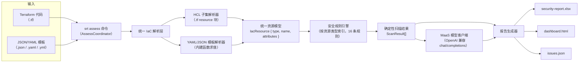

# 架构说明

## 1. 定位

本工具是一个**本地运行的 IaC 安全审查 CLI**（`srt`）：对基础设施即代码执行**确定性规则扫描**，并用 **MaaS 预置模型服务（ModelArts Studio）** 辅助威胁建模与修复建议，最终产出 Excel / HTML / JSON 三类报告。工具不部署在云上，仅大模型推理依赖云端 API。

## 2. 总体架构

## 3. 模块职责

| 模块 | 路径 | 职责 |
|---|---|---|
| CLI 入口 | `src/index.ts` | commander 注册 5 个命令（assess / fix / config / status / update）；无子命令时默认执行 assess |
| 扫描协调 | `src/assess/coordinator.ts` | 发现 IaC 文件 → 矩阵扫描 → 可选威胁建模 → 生成报告 |
| IaC 解析 | `src/assess/scanning/security-matrix/iac-utils.ts` | 按扩展名分发：`.tf` → HCL 解析；`.yaml/.yml/.json` → 模板解析；归一化为统一资源模型 |
| HCL 解析 | `src/assess/scanning/security-matrix/hcl-parser.ts` | 解析 `resource "type" "name" { ... }` 块：标量 / list / map / 嵌套块；同名嵌套块折叠为数组；忽略变量声明与表达式求值 |
| 模板解析 | `src/assess/scanning/security-matrix/cfn-yaml.ts` | js-yaml 扩展 short-form 内建函数标签（`!Ref` / `!Sub` 等 17 个），替代第三方依赖 |
| 规则引擎 | `src/assess/scanning/security-matrix/matrix-scanner-engine.ts` | 按资源类型建索引，逐资源执行匹配规则求值，产出 `ScanResult[]` |
| 规则库 | `src/assess/scanning/security-matrix/rules/huaweicloud/` | 10 个服务目录共 16 条规则（见 §4），全部针对 `huaweicloud_*` 资源类型 |
| 模型层 | `src/shared/ai/` | `ModelConfig`（端点/密钥/模型 ID 单例，密钥不落盘）+ `ModelClient` 抽象 + `MaasModelClient`（OpenAI 兼容 fetch 实现） |
| 威胁建模 | `src/assess/template-processing/threat-modeler.ts` | 高危结果 → MaaS 生成威胁模型与修复建议；未配置密钥时优雅降级为跳过 |
| 报告生成 | `src/assess/reporting/report-generator.ts` | Excel（exceljs）/ HTML 仪表盘 / issues.json |
| 配置管理 | `src/config/` | `srt config` 命令：写入 `.srt/srtconfig.json`（不落 API Key），并校验模型连通性 |
| 其他命令 | `src/fix/`、`src/status/`、`src/update/` | 问题清单交互、最近审查摘要、版本检查（更新源可配置） |

## 4. 内置安全规则（16 条）

| 服务 | 规则 ID | 优先级 | 检测内容 |
|---|---|---|---|
| OBS | OBS-001 | HIGH | 桶未启用服务端加密 |
| OBS | OBS-002 | HIGH | 桶 ACL / 策略允许公开读写 |
| 安全组 | SEC-001 | HIGH | 入站规则允许全网（0.0.0.0/0）访问 |
| 安全组 | SEC-002 | HIGH | SSH(22)/RDP(3389) 管理端口对全网开放 |
| CCE | CCE-001 | HIGH | 集群控制面开放公网访问 |
| CCE | CCE-002 | MEDIUM | 集群未启用审计日志 |
| RDS | RDS-001 | HIGH | 数据库实例开放公网访问 |
| RDS | RDS-002 | MEDIUM | 实例未启用自动备份 |
| ECS | ECS-001 | MEDIUM | 云服务器直接绑定弹性公网 IP |
| ELB | ELB-001 | HIGH | 监听器未启用 TLS 加密 |
| ELB | ELB-002 | LOW | 负载均衡未开启访问日志 |
| GaussDB | GAUSS-001 | MEDIUM | 数据库实例未启用自动备份 |
| GaussDB | GAUSS-002 | HIGH | 数据库实例开放公网访问 |
| FunctionGraph | FGS-001 | HIGH | 函数环境变量含明文敏感信息 |
| IAM | IAM-001 | HIGH | 委托授予过高权限 |
| VPC | VPC-001 | LOW | 弹性公网 IP 疑似孤立未绑定 |

## 5. 数据流

1. **发现**：`discoverIacFiles()` 递归扫描目标目录，匹配 `**/*.tf`、`**/*.yaml`、`**/*.yml`、`**/*.json`，排除 `node_modules`、`.git`、`.terraform`、`build`、`dist`、`cdk.out`、`.srt` 等目录；JSON 文件按 template / stack / config / parameter 关键字过滤，避免误扫普通配置。
2. **解析**：按扩展名进入对应解析器，输出统一资源模型。
3. **扫描**：引擎按 `resource.type` 查规则索引，逐个执行 `rule.evaluate()`；规则命中即产出 `ScanResult`（含 check_id、优先级、问题描述、修复建议）。
4. **增强（可选）**：存在高危结果且已配置模型密钥时，调用 MaaS 对高危项做威胁建模；未配置则跳过（不影响确定性结果）。
5. **报告**：汇总写入 `.srt/`：`security-report.xlsx`、`dashboard.html`、`issues.json`，控制台打印分级摘要。

## 6. 配置与凭据

- 配置存储：`<项目>/.srt/srtconfig.json`（端点、模型 ID、安装 ID、遥测开关）
- **API Key 不落盘**：仅从环境变量 `MODEL_API_KEY` 注入，`srt config --api-key` 交互输入仅用于连通性校验
- 默认端点：`https://api.modelarts-maas.com/v2`；默认模型：`DeepSeek-V3.2`；均可通过 `srt config` 或环境变量覆盖
